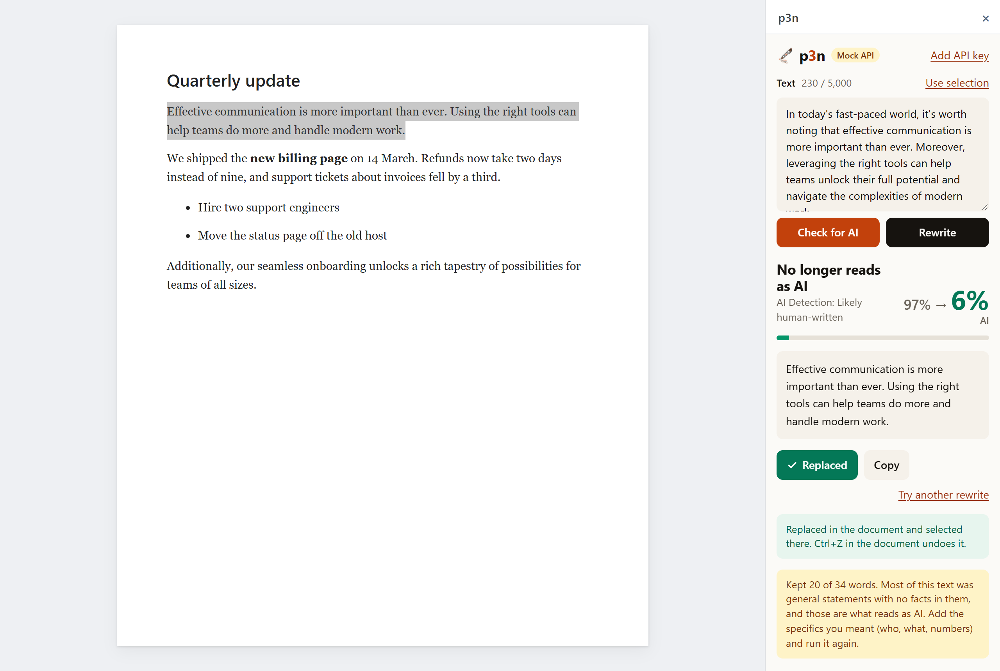

# Contributing

An Apps Script **Editor add-on**: `src/` is what goes to Google, plain Apps Script and HTML with no build step. `dev/` holds the tests and tools, and isn't uploaded.

## Layout

| File | Does |
| --- | --- |
| `src/Code.js` | Apps Script: the menu, opening the sidebar, reading the selection, replacing it, saving or removing the key. |
| `src/dev.js` | Mock mode on and off. Development only: a release push leaves it out (below). |
| `src/Sidebar.html` | The sidebar's markup. Pulls in the parts below as Apps Script template includes. |
| `src/host.html` | The Docs adapter, the only sidebar code that knows it runs in Docs: the key (user properties via `Code.js`), the free count, `grabSelection()` → `{ text, editable, blocked }`, `replace(text)` → `{ ok, reason }`, `copy`. |
| `src/app.html` | The controller: the text box, running a check or rewrite, Replace, the key screen. Reaches the document only through the adapter, and p3n only through the API client. |
| `src/render.html` | Results and their motion: score count-up, highlighter sweep, rewrite wipe, check marks, error copy. |
| `src/api.html` | The API client, the [browser extension's](https://github.com/Barabosik/p3n-chrome-extension) `lib/api.js` as a plain script: `POST /v1/detect` and `/v1/humanize`, polling `/v1/runs/{id}`, readable errors. Every call names the add-on as `p3n-gdocs/<version>` (`X-P3N-Client`), from the one `VERSION` constant. |
| `src/mock.html` | Canned API answers for mock mode and the tests. |
| `src/styles.html` | Additions to Google's CSS package for Editor add-ons (linked in `Sidebar.html`): p3n's logo, wordmark, score colours and motion, in Docs' 300px sidebar. |
| `src/appsscript.json` | Manifest: V8 and the two scopes. |
| `dev/` | The local harness, the tests, the icons. |

Apps Script pages have no modules or separately served files, so each browser part is an `.html` include that sets one global (`window.P3N_API`, `P3N_RENDER`, `P3N_HOST`). `.js` files under `src/` run on Google's servers, not in the sidebar.

## Tests

```bash
npm install
npm test            # Code.js against a stand-in for DocumentApp, and api.html's request headers (17 tests)
npm run e2e         # the sidebar in headless Chrome on the local harness, mock API (36 checks)
npm run harness     # http://127.0.0.1:8787/?mock=1, to try the sidebar by hand
LIVE=1 npm run e2e  # adds one live Check and Rewrite: 2 of the 10 free calls an hour
```

- `npm test` checks reading across paragraphs, soft line breaks, a word range replaced with the majority formatting, edge spaces, whole paragraphs, several paragraphs with an untouched heading, links, the refusals (edited text, tables, pictures), the find-once fallback and the key format.
- `npm run e2e` runs the real sidebar next to a stand-in document: Check, Rewrite and Replace on one and on several paragraphs, the refusals, typed text, Copy, nothing selected, the menu's jobs, the free limit, the key screen, reduced motion and page errors. Captures go to `dev/out/`. Set `CHROME=` if Chrome isn't in the default Windows location.
- The harness tests the sidebar, not Docs. CI runs both suites on every push.



## Try it in Google Docs

You need Node 18+ and a Google account to test with.

1. Turn on the Apps Script API for that account at <https://script.google.com/home/usersettings>.
2. `npx clasp login`, and pick that account. The token stays in `~/.clasprc.json`. Revoke "clasp" at <https://myaccount.google.com/permissions> when you're done.
3. Make a test document with the add-on bound to it:
   ```bash
   npx clasp create --type docs --title "p3n test" --rootDir src
   git checkout src/appsscript.json   # clasp swaps in its default manifest
   npm run push:dev
   ```
   `.clasp.json` now holds your script and document IDs. Git ignores it, and `.clasp.json.example` shows the format.
4. Open the document, reload it, and use **Extensions → p3n test**. Google warns that the app isn't verified (**Advanced → Go to p3n test**), then lists the two scopes as checkboxes: tick both.

After a change: `npm run push:dev`, then reopen the sidebar.

**Mock mode.** In the Apps Script editor (`npm run open`), run `devMockOn`, then reopen the sidebar. It shows a *Mock API* badge and answers from `src/mock.html`, so no free calls are used. `devMockOff` turns it off.

**Dev and release pushes.** `npm run push:dev` sends all of `src/`. `npm run push` (and `dev/standalone.mjs`) leaves out `src/dev.js`, as `.claspignore` says. Without that file there's no mock mode, so a release build always calls p3n and never shows the badge. Push the published project only with `npm run push`. `npm test` checks both ignore files.

**Several Google accounts.** With more than one account signed in, and the document owned by one that isn't the browser's default, Apps Script refuses every call from the sidebar ("PERMISSION_DENIED … reading from storage", a [known bug](https://discuss.google.dev/t/how-is-everyone-handling-the-dreaded-authuser-0-multiple-accounts-bug-in-apps-script-add-ons/363446)). Reading the selection, Replace and the key stop working, while typed text still works. Test in a browser profile signed in to one account. The sidebar's error tells users the same.

## How it works

**An Editor add-on, not a Workspace add-on.** Only an Editor add-on sees the selection: a Workspace add-on's Docs event carries the document's ID and nothing about a cursor. Editor add-ons also draw their sidebar in HTML, which the p3n motion needs. The cost: desktop browsers only, no Docs mobile apps.

**The sidebar calls the API itself**, with `fetch` from the user's browser. So calls without a key use the user's IP and its 10 free calls an hour. From Apps Script's `UrlFetchApp` they would share Google's IPs with everyone, and need one more scope (`script.external_request`). The API key, if the user adds one, lives in `PropertiesService.getUserProperties()`: per user, never in the document.

**Scopes**, fixed in `src/appsscript.json`:

| Scope | For |
| --- | --- |
| `documents.currentonly` | Reading the selection and replacing it, only in the document the add-on is open in. |
| `script.container.ui` | The Extensions menu and the sidebar. |

**Replace** (`replaceSelection` in `src/Code.js`):

- It writes only if the selection still reads as the text that was rewritten. If the selection moved, it looks for that text and replaces it there, but only within one paragraph and only if it appears once.
- Each selected paragraph goes to the API as a separate paragraph and comes back as one, so headings, list items and spacing stay. Paragraphs the rewrite left alone aren't touched.
- New words take the formatting most of the old words had. A bold phrase inside a rewritten paragraph comes back plain. A link stays only if the whole selection was that link.
- The API's trailing line break never becomes an empty paragraph.
- It won't write over tables (text inside a table cell included), pictures, drawings, equations, footnotes or smart chips. Check and Copy still work there.
- It all happens in one server call, so one Ctrl+Z takes it back, formatting included.

## Checked in Google Docs

Checked by hand in a real document, in mock mode:

- The menu, the consent screen and the sidebar.
- `fetch` to `api.p3n.si` from the sidebar.
- Check, Rewrite and Copy.
- Reading the selection, Replace on one paragraph and on six (heading, bold, bullets), and one-step undo.
- Saving the key.
- A soft line break (Shift+Enter): Replace keeps it inside the one paragraph, and Ctrl+Z restores it.
- Text in a table cell: no Replace ("The selection has a table in it"), even with only the cell's text selected, because Docs hands over the cell, not just its text. Check and Copy work, and the document stays as it was.
- A line with a picture in it: no Replace, the picture note, and Copy.
- A second document tab: Replace changes only that tab's text, and Ctrl+Z restores it.

Then live, as the standalone project in a test deployment: the unverified-app screen, consent to both scopes, and Check, Rewrite, Replace selection and Ctrl+Z on the real API.

## Publishing

The Marketplace copy is in [store/listing.md](store/listing.md) and the steps in [store/marketplace-steps.md](store/marketplace-steps.md). The homepage, privacy policy and terms that Google's consent screen and listing link to are in `docs/`, served by GitHub Pages. `docs/privacy.html` and `PRIVACY.md` say the same thing: change both. `python dev/banner.py` makes the listing's card banner, and `python dev/store-shots.py --crop 608,0,1952,1220 shot1.png shot2.png` fits Docs screenshots onto the listing's 1280×800 (the crop is for a maximized window on a 2560-pixel-wide screen). `node dev/standalone.mjs` creates and pushes the standalone project the listing points to.
