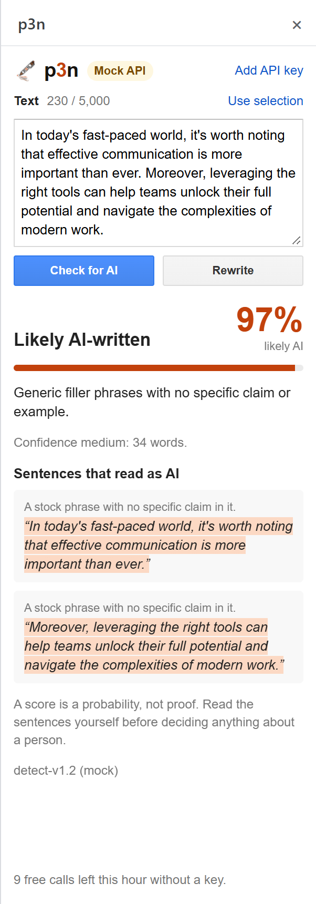
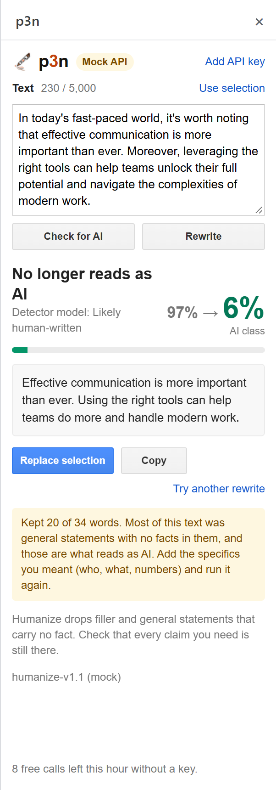

  

<h1 align="center">p3n for Google Docs</h1>

  Select text in a Google Doc. See if it reads as AI-written, or rewrite it and put the new version in its place.

  Google Workspace Marketplace (not listed yet) · <a href="https://barabosik.github.io/p3n-google-docs-addon/">Homepage</a> · <a href="https://p3n.si">p3n.si</a>

  

  
  

## What it does

- **Check for AI.** A score, a one-line reason, and the sentences that give it away.
- **Rewrite.** A version that keeps your facts and drops the filler. **Replace selection** puts it where your text was, with headings, lists and formatting kept, and one Ctrl+Z undoes it.
- It works from **Extensions → p3n** or the sidebar. Text you paste into the sidebar works too.

## Free, or with a key

You get 10 checks or rewrites an hour without an account, up to 5,000 characters each. For more, make an API key at [p3n.si](https://p3n.si/dashboard/keys) and paste it into the sidebar (Add API key).

## Privacy

The add-on sends the text you chose to `api.p3n.si`, and only when you click Check or Rewrite. It can open only the document you use it in. It keeps no history, has no analytics, and never stores anything in your document. Your API key stays in your Google account's settings for this add-on. The details are in [PRIVACY.md](PRIVACY.md).

## Try it before it's listed

Until the Marketplace listing is live, you can run your own copy with [clasp](https://github.com/google/clasp): the steps are in [CONTRIBUTING.md](CONTRIBUTING.md#try-it-in-google-docs).

## Known gaps

- If you're signed in to several Google accounts and the document isn't on your default one, Google blocks the add-on from reading the document. Use a browser window with just that account.
- Google's Docs apps for phones and tablets don't run add-ons.

## Develop

Layout, tests and how Replace works are in [CONTRIBUTING.md](CONTRIBUTING.md).

## Licence

MIT
