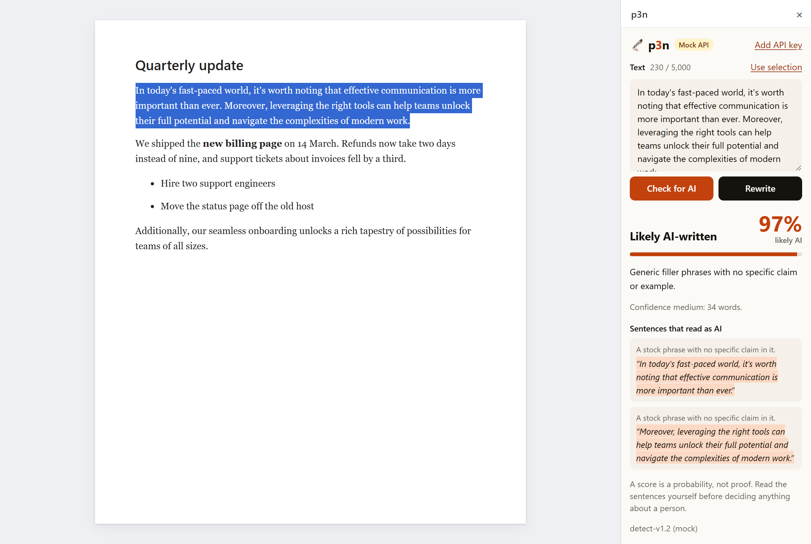
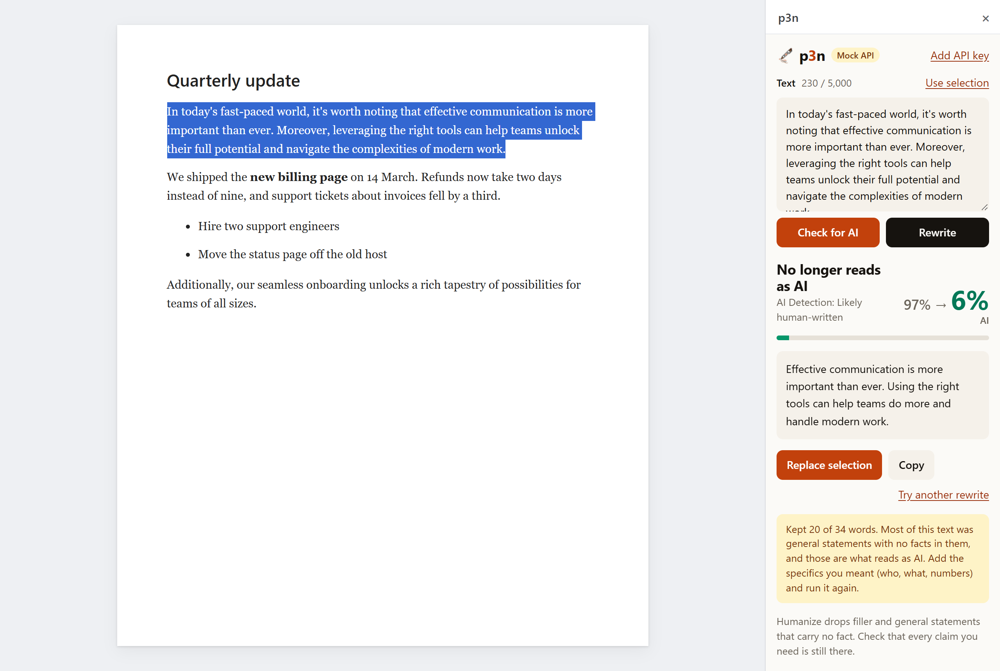

# p3n for Google Docs

Select text in a Google Doc and see whether it reads as AI-written. Or rewrite it so it doesn't, and put the rewrite back in place of your selection, formatting kept. It uses the [p3n API](https://p3n.si/docs): the same Check and Rewrite skills as p3n.si, the browser extension and the Word add-in.




*Captured in the local harness (`dev/harness.mjs`) with the mock API: the real sidebar next to a stand-in document, not Google Docs itself.*

Version 0.1.0. Not on the Google Workspace Marketplace yet; install it as a test deployment (below).

## Use

- Select text in the document, then **Extensions → p3n → Check selection for AI** or **Rewrite selection**. The sidebar opens and runs it.
- Or **Extensions → p3n → Open p3n** and use the buttons. With the sidebar open, select other text and click **Check for AI** or **Rewrite** again: they always take the current selection while the box shows text from the document. Text you type or paste in the box is used as it is.
- After a rewrite, **Replace selection** puts it in place of the selected text and selects it. Ctrl+Z (Cmd+Z on a Mac) in the document undoes it. **Copy** is there too.
- Docs' own right-click menu can't be extended by add-ons (and the browser extension's menu doesn't show in Docs either), so the entry points are the Extensions menu and the sidebar.

## Editor add-on, not a Workspace add-on

Google has two kinds of add-on for Docs ([add-on types](https://developers.google.com/workspace/add-ons/concepts/types)). This is an **Editor add-on**, because:

- **The selection.** An Editor add-on runs inside the open document, so `DocumentApp.getActiveDocument().getSelection()` gives the selected range with its offsets; Google's own [translate-the-selection quickstart](https://developers.google.com/workspace/add-ons/editors/docs/quickstart/translate) is an Editor add-on. A Workspace add-on's Docs event object carries only the document's ID and title, and only after a per-file `drive.file` grant ([event objects](https://developers.google.com/workspace/add-ons/concepts/event-objects)); nothing about a selection or cursor.
- **The interface.** Editor add-ons draw their sidebar in HTML and CSS. Workspace add-ons are built from Card service widgets, which can't do the score count-up, the highlighter sweep, the rewrite wipe or the p3n colours the other p3n clients share.
- **What it costs.** Editor add-ons run on desktop browsers only (no Docs mobile apps), must be written in Apps Script, and have stricter authorization rules. A Workspace add-on would reach Gmail and the other apps with one listing, but this one is about text in Docs. Google still documents and lists Editor add-ons; Workspace add-ons are the newer kind, not a replacement Google requires.

## Keys and IPs: why the sidebar calls the API itself

The free tier allows 10 calls an hour per IP. Where the call comes from decides whose IP that is:

| | From the sidebar (browser `fetch`) - **chosen** | From Apps Script (`UrlFetchApp`) |
| --- | --- | --- |
| Keyless calls | the user's own IP: each user gets their own 10 an hour | Google's shared servers: the 10 an hour is shared with every other Apps Script caller, so in practice a key is required |
| Extra OAuth scope | none | `script.external_request` (one more scope on the consent screen and in verification) |
| Long rewrites | the sidebar polls `/v1/runs/{id}` itself; closing the sidebar cancels | the server function would have to poll inside Apps Script's time limits |
| API key | kept in the user's own properties, handed to the sidebar when it opens, sent from their browser as a bearer token | the same, but sent from Google's servers |
| Depends on | the sidebar's sandbox allowing `fetch` to `api.p3n.si` (the API answers CORS for any origin and exposes `X-Free-Remaining`) | nothing in the browser |

So keyless use works as it does on p3n.si, and a key is optional, as it is in the extension and the Word add-in. The key is stored with `PropertiesService.getUserProperties()`: per user and per add-on, in the user's Google account, never in the document (document properties would be readable by every editor and would travel with copies). If Google ever blocks `fetch` from add-on sidebars, the fallback is `UrlFetchApp` with a required key.

## Install (test deployment)

You need Node 18+, a Google account and a Google Doc to test in.

1. `npm install` in this folder.
2. Turn on the Apps Script API for your account: <https://script.google.com/home/usersettings>.
3. `npx clasp login` (opens a Google sign-in in the browser).
4. Create the Apps Script project, standalone so it can later be published:
   ```bash
   npx clasp create --type standalone --title "p3n for Google Docs" --rootDir src
   ```
   This writes `.clasp.json` (ignored by git; `.clasp.json.example` shows its shape). With an existing project, copy the example and paste its script ID. If clasp pulled a default `appsscript.json` over ours, `git checkout src/appsscript.json`.
5. `npm run push` uploads `src/` (it asks once to overwrite the manifest: yes).
6. `npm run open` opens the project in the Apps Script editor. There: **Deploy → Test deployments → Install** (pick *Editor add-on* if asked), or **Select type → Editor Add-on → Test with latest code**, choose your test document, and **Execute** it. The document opens with **Extensions → p3n for Google Docs**.
7. The first menu click asks for the scopes below. Google shows its "Google hasn't verified this app" screen until the add-on is verified: **Advanced → Go to p3n for Google Docs (unsafe)** for your own test.

After a change, `npm run push` and reload the document.

**Mock mode:** in the Apps Script editor, run `devMockOn` (Run menu, function picker), then reopen the sidebar. It shows a *Mock API* badge and answers from canned runs in `src/mock.html`: nothing goes to p3n and no free calls are used. `devMockOff` turns it off. Both change only your own properties.

## Scopes

Set in `src/appsscript.json`, so Apps Script doesn't widen them.

| Scope | Why |
| --- | --- |
| `documents.currentonly` | Read the selection and replace it, in the document the add-on is used in, and no other. |
| `script.container.ui` | The Extensions menu entries and the sidebar. |

Nothing else: no Drive access, no other documents, no `script.external_request` (the API is called from the browser, see above), no email address. `PropertiesService` (the API key) needs no scope.

## Privacy: what it sends

- Only the text you select or type, and only when you click Check or Rewrite (or choose them in the Extensions menu). It goes from your browser to `api.p3n.si` and nowhere else.
- Opening the sidebar reads your current selection into the box so you can see it; that read stays between Docs and the sidebar.
- No history, no analytics, nothing stored in the document. Replace writes only the rewrite you asked for, in place of the text you selected.
- Your API key, if you add one, is kept in your Google account's settings for this add-on (Apps Script user properties). Other people with access to the document can't see it.
- Apps Script errors are logged to the add-on's Google Cloud project (`exceptionLogging: STACKDRIVER`); the code puts no document text in error messages.

## How Replace works

`replaceSelection` in `src/Code.js`:

- It writes only if the selected text is still exactly what was rewritten. If the selection moved (you clicked in the document while waiting), it finds the text you sent and replaces it there, but only for a single paragraph that appears exactly once; otherwise it refuses and says why.
- The API reads a blank line as a paragraph break, so each selected paragraph goes over as a paragraph of its own, and the rewrite comes back one paragraph per paragraph. Each goes back into its own paragraph, so headings, list items, alignment and spacing stay. Paragraphs the rewrite left as they were (short ones such as headings) aren't touched at all.
- Inside a paragraph, the new words take the character formatting most of the old words had (bold, italic, font, size, colours). A link is kept only if the whole selection was that one link. The spaces at the edges of the selection stay.
- The rewrite ends with `"\n"`; that never becomes an empty paragraph. The new text goes in before the old is deleted, so no paragraph is left empty in between.
- It won't write over a selection with a table, picture, drawing, equation, footnote or smart chip in it. Check and Copy still work there.
- All edits happen in one server call. Ctrl+Z in the document undoes them; whether Docs takes them back in one step is part of the live test below.

## Files

| File | Does |
| --- | --- |
| `src/Code.js` | Apps Script: the menu, opening the sidebar, reading the selection, replacing it, saving or removing the key, mock mode on and off. |
| `src/Sidebar.html` | The sidebar's markup. Pulls in the parts below as Apps Script template includes. |
| `src/app.html` | The sidebar's logic, ported from the extension's `ui/panel.js` and the Word add-in's task pane: checks, rewrites, the result and its motion, Replace, the key screen. |
| `src/api.html` | The API client, the extension's `lib/api.js` as a plain script: `POST /v1/detect` and `/v1/humanize`, polling `/v1/runs/{id}`, readable errors. |
| `src/mock.html` | Canned API runs for mock mode and the tests. |
| `src/styles.html` | p3n colours and motion, the extension's CSS fitted to Docs' 300px sidebar. |
| `src/appsscript.json` | Manifest: V8, the two scopes. |
| `dev/` | Not uploaded: the local harness, tests, icons. |

Motion is kept to the result, as in the other clients: the score counts to its value and changes colour band by band, flagged sentences get a highlighter sweep, a rewrite wipes in, Replaced draws a check mark, the key screen slides in. With reduced motion on, the end state shows at once.

## Tests

```bash
npm test          # Code.js against a stand-in for DocumentApp (13 tests)
npm run e2e       # the sidebar in headless Chrome, on the local harness, mock API (25 checks)
LIVE=1 npm run e2e  # adds one Check and one Rewrite on the live API, keyless: 2 of the 10 free calls an hour
npm run harness   # the harness on http://127.0.0.1:8787/?mock=1, to try the sidebar by hand
```

- `npm test` loads `src/Code.js` with a small in-memory DocumentApp (Text elements with per-character attributes, range elements with inclusive offsets) and checks: reading across paragraphs, soft line breaks, replacing a word range with the majority formatting, the edge spaces, whole paragraphs, several paragraphs with an untouched heading, links, the refusals (edited text, tables, pictures), the find-once fallback, a dropped paragraph, and the key format.
- `npm run e2e` checks Check, Rewrite and Replace on one paragraph and on several, Check again after Replace, the edited-text refusal, typed text (no Replace), nothing selected, the menu's Check-on-open, the free limit, the key screen (malformed, accepted, revoked, removed), reduced motion, and no page errors. Captures go to `dev/out/`. `CHROME=path/to/chrome` if Chrome isn't in the default Windows location.
- The harness's document side mimics `Code.js` on a web page, so it tests the sidebar, not Docs. What only Docs can show is in the live test below.

### Live test in Google Docs

Not run yet: it needs a Google sign-in for clasp and a test document. The checks, in a test document, with mock mode first and then two live calls:

- The sidebar's `fetch` to `api.p3n.si` works from the add-on sandbox (the keyless choice above depends on it).
- Check and Rewrite on a selection; Replace keeps the paragraph's style and the words' formatting; no empty paragraph appears; the new text is selected.
- Ctrl+Z in the document undoes the whole Replace in one step.
- Several paragraphs including a heading and a list item; a selection with a soft line break; a selection in a table cell; a selection that includes a picture (refused).
- A document with tabs: selection in the second tab.
- The key saved in the sidebar survives closing and reopening it, and isn't visible from another account with access to the document.

## What needs the owner

To publish on the Google Workspace Marketplace under ZDResearch:

1. **Publisher account.** Decide which ZDResearch Google account (ideally a Google Workspace account on a ZDResearch domain) owns the Apps Script project and the listing; move the project to it.
2. **Google Cloud project.** A standard Cloud project owned by ZDResearch, linked to the script (Project Settings → Google Cloud Platform project). The default Apps Script project can't be published.
3. **OAuth consent screen** (External): app name p3n, the p3n logo, a support email, `p3n.si` as an authorized domain (verified in Google Search Console), and links to <https://p3n.si/privacy> and <https://p3n.si/terms>. The privacy policy needs a section on the Docs add-on: what it reads (only the text the user sends), that it keeps nothing, and Google's [API Services User Data Policy](https://developers.google.com/terms/api-services-user-data-policy) "Limited Use" statement.
4. **OAuth verification** for the two scopes. The Cloud console marks each scope sensitive or not; Google may ask for a demo video of the add-on using them. Until it's verified, users see the unverified-app warning and Google caps how many can authorize it.
5. **A versioned deployment** (Apps Script: Deploy → New deployment → Add-on), whose version number goes into the Marketplace SDK.
6. **Google Workspace Marketplace SDK** in the Cloud project: App configuration (Docs add-on, the script ID and version), Store listing (name, short and long description, category, icons 32x32 and 128x128, a 220x140 card banner, 1280x800 screenshots from a real Docs run, support, privacy and terms URLs), visibility Public, then submit for Google's review.

Also open for a later version: a Workspace add-on alongside (for Gmail, say), and the Docs mobile apps, which Editor add-ons can't reach.
